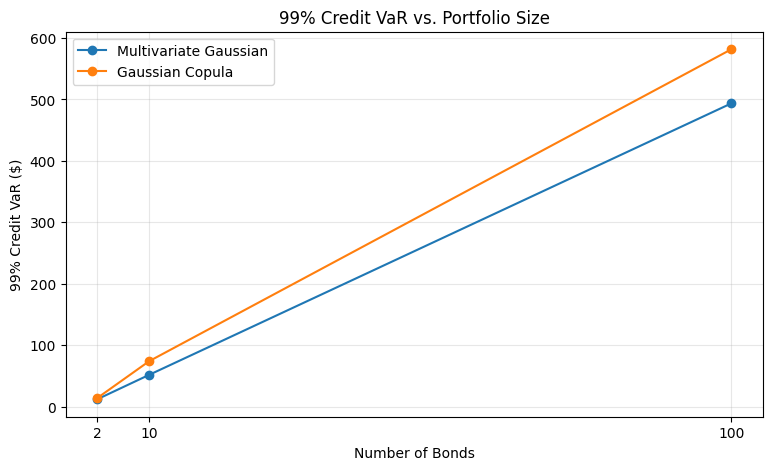

# Credit Risk: Gaussian vs. Gaussian Copula

I wanted to see how much a portfolio of corporate bonds could lose when credit ratings change, especially when the issuers are exposed to the same bad economic conditions.

## Why this problem matters

Looking at the default probability of one bond is not enough to understand the risk of a portfolio. A bond can lose value when its rating falls even if it does not default. And if several companies run into trouble at once, portfolio losses can be much larger.

This project is a small way to test that idea. I compare a simple normal approximation with a model that keeps the actual rating transition probabilities and uses a Gaussian copula to link the bonds.

## What I did

- Started with two BBB-rated bonds and the one-year transition probabilities and bond values provided in class.
- Calculated the mean and variance of the future bond value.
- Simulated **1,000,000** future portfolio values using (A) a multivariate Gaussian approximation and (B) a Gaussian copula with discrete rating outcomes.
- Used a **0.5** Gaussian dependence parameter in both methods.
- Calculated the 99th percentile of portfolio losses and repeated the analysis for **10** and **100** bonds.
- Checked the simulated default probabilities against the original table.

For the larger portfolios, each bond has the same marginal distribution. A common normal factor creates dependence across issuers, while each issuer also has its own shock.

## Main results

The following VaR figures measure losses relative to the **expected future portfolio value**, following the class example.

| Number of bonds | Gaussian 99% VaR | Gaussian copula 99% VaR |
| ---: | ---: | ---: |
| 2 | $12.05 | $14.06 |
| 10 | $51.70 | $73.92 |
| 100 | $493.60 | $581.64 |



For two bonds, the expected future value is about **$214.18**. The mean net loss against this reference is close to zero by construction. To provide a separate benchmark, I also use the **BBB state value of $107.55 per bond**. The expected *net migration loss* relative to that BBB benchmark is about **$0.92** for two bonds, **$4.62** for ten and **$46.21** for one hundred. This is not a market-price-based or regulatory expected credit loss estimate; no separate current market price was provided.

## What I learned

The Gaussian copula produces a higher 99% VaR in all three portfolios in this example. The main reason is not a different correlation assumption: both models use the same Gaussian dependence parameter. It is the **shape of the bond-value distribution**. A normal approximation is symmetric, while the rating-based model allows for much larger losses if a bond defaults.

Adding more bonds increases the total amount at risk because the position is bigger. Risk **per bond** generally benefits from diversification, but it cannot disappear when all issuers share a common factor. With discrete ratings, the 99th percentile can also jump rather than change smoothly as bonds are added.

## Files

- [`Project2_CreditRisk.ipynb`](Project2_CreditRisk.ipynb) — analysis and Monte Carlo simulations in Python.
- [`slides/Project2_CreditRisk_Summary.pptx`](slides/Project2_CreditRisk_Summary.pptx) — three-slide summary of the question, models and results.
- [`figures/`](figures/) — plots exported from the notebook.
- [`requirements.txt`](requirements.txt) — Python packages needed to run the notebook.

## Running the notebook

Using Python 3.10 or newer:

```bash
python -m pip install -r requirements.txt
jupyter notebook Project2_CreditRisk.ipynb
```

Run the cells from top to bottom. The notebook uses a fixed random seed so that the Monte Carlo results can be reproduced. Small differences are still possible with different versions of numerical libraries.
